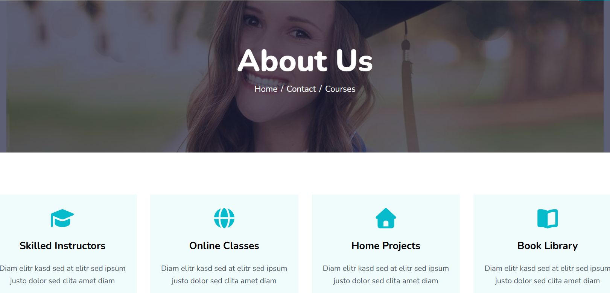
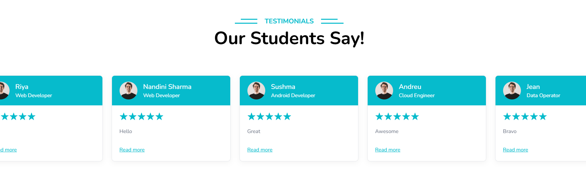
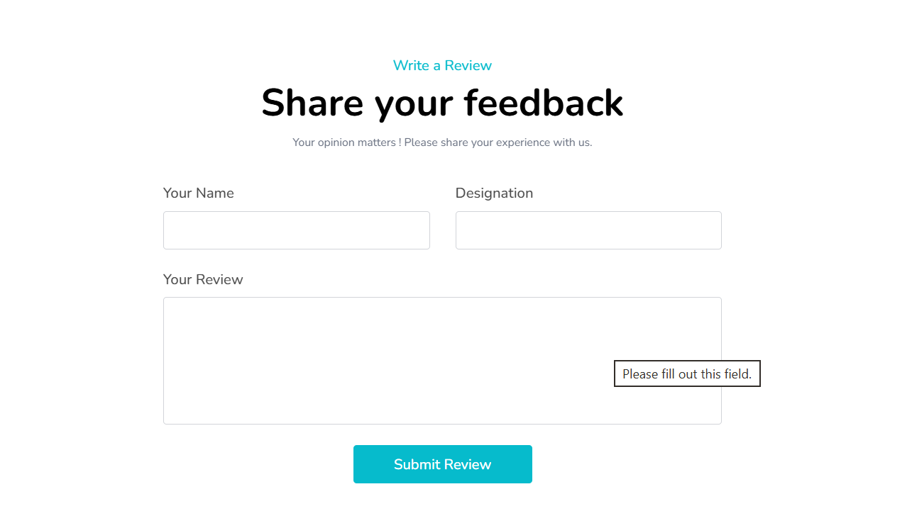
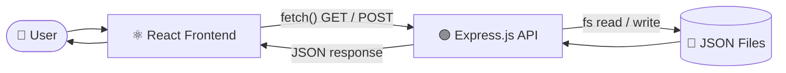

<div align="center">

# 🎓 e-Learning Website

### A full-stack learning platform where users explore courses, get in touch, and share real testimonials, powered by a custom React frontend and a Node/Express REST API.


[📂 Repository](https://github.com/student-BPSMV/e-Learning-Website) · [✨ Features](#-features) · [📸 Screenshots](#-screenshots) · [🔌 API](#-rest-api) · [⚙️ Setup](#️-getting-started)


</div>

---

## 📌 About the Project

The **e-Learning Website** is a full-stack web application that promotes skilled instructors, diverse courses and unique learning techniques. It combines a clean, responsive **React** interface with a lightweight **Node.js + Express** backend that handles form submissions and serves testimonial data through REST APIs.

I built it to practise the full development loop end to end: designing reusable UI components, wiring up client-side routing, handling forms, building and consuming REST endpoints, and persisting data on the server.

> **TL;DR:** React + Tailwind frontend → `fetch()` → Express REST API → JSON file storage → dynamic UI updates.

---

## ✨ Features

| | Feature | Details |
|---|---|---|
| 📱 | **Fully responsive UI** | Built mobile-first with Tailwind CSS |
| 🧭 | **Client-side routing** | Smooth page navigation with React Router |
| 📚 | **Course browsing** | Course cards with price, rating, instructor, duration and student count |
| 🔍 | **Search & filtering** | Find the right course quickly |
| 📩 | **Contact form** | Name, email, subject and message are posted to the backend and saved in `data.json` |
| ⭐ | **Testimonial submission** | Visitors can submit their name, designation and review |
| 🔄 | **Live testimonial feed** | Reviews are fetched from the API and rendered dynamically |
| 🎠 | **Scrollable testimonial carousel** | Newly added reviews appear without editing any code |
| ✨ | **Scroll animations** | AOS (Animate On Scroll) for a polished feel |
| 🧩 | **Reusable components** | Navbar, Footer, Hero, Course cards, Testimonials and more |
| ✅ | **Form validation** | Required-field checks guard the forms |

---

## 📸 Screenshots

### 🏠 Home / Hero Section


### 📖 About Page


### 📚 Popular Courses


### ⭐ Student Testimonials


### 📝 Share Your Feedback (Testimonial Form)


---

## 🛠️ Tech Stack

**Frontend**

| Technology | Purpose |
|---|---|
|  | Component-based UI |
|  | Application logic and interactivity |
|  | Fast dev server and build tool |
|  | Responsive, utility-first styling |
|  | Client-side routing |
| **AOS** | Scroll-based animations |
|  | Icons |

**Backend**

| Technology | Purpose |
|---|---|
|  | JavaScript runtime |
|  | Server and REST API |
| **CORS** | Secure frontend ↔ backend communication |
| **`fs` module** | Reading and writing JSON data |
| **JSON files** | Lightweight data storage |

> Prebuilt UI templates were used as a design foundation and then customised to fit the project's requirements.

---

## 🏗️ Architecture



**Contact form flow**

```text
Contact Form  →  POST /api/submit  →  Express.js  →  backend/data.json
```

**Testimonial flow**

```text
Feedback Form  →  POST /api/testimonials  →  Express.js  →  backend/test.json
                                                                   │
Testimonials Section  ←  GET /api/testimonials  ←──────────────────┘
```

---

## 🔌 REST API

| Method | Endpoint | Description |
|:---:|---|---|
| `POST` | `/api/submit` | Stores contact form data in `backend/data.json` |
| `GET` | `/api/testimonials` | Returns all testimonials |
| `POST` | `/api/testimonials` | Adds a new testimonial to `backend/test.json` |

<details>
<summary><b>📥 Example: add a testimonial</b></summary>

```http
POST /api/testimonials
Content-Type: application/json
```

```json
{
  "name": "John Doe",
  "designation": "Web Developer",
  "review": "An excellent learning experience."
}
```

</details>

<details>
<summary><b>📩 Example: submit the contact form</b></summary>

```http
POST /api/submit
Content-Type: application/json
```

```json
{
  "name": "Jane Doe",
  "email": "jane@example.com",
  "subject": "Course enquiry",
  "message": "I'd like to know more about the web development course."
}
```

</details>

---

## 📁 Project Structure

```text
e-Learning/
│
├── frontend/                 # React + Vite application
│   ├── public/
│   ├── src/
│   │   └── components/       # Reusable UI components
│   └── package.json
│
├── backend/                  # Express REST API
│   ├── server.js             # Routes and server setup
│   ├── data.json             # Contact form submissions
│   ├── test.json             # Testimonials
│   └── package.json
│
└── README.md
```

---

## ⚙️ Getting Started

### Prerequisites

* [Node.js](https://nodejs.org/) (v16 or later recommended)
* npm

### 1️⃣ Clone the repository

```bash
git clone https://github.com/student-BPSMV/e-Learning-Website.git
cd e-Learning-Website
```

### 2️⃣ Start the backend

```bash
cd backend
npm install
node server.js
```

### 3️⃣ Start the frontend

Open a **second terminal**:

```bash
cd frontend
npm install
npm run dev
```

Vite will print the local URL in the terminal (usually `http://localhost:5173`). Keep the backend running so the contact form and testimonials work.

---

## 🎯 What I Learned

* Structuring a React app with **reusable components** and **React Router**
* Handling **controlled forms** and validation in React
* Consuming APIs with **`fetch()`** and rendering live data
* Designing **REST endpoints** with Express (GET and POST)
* Reading and writing data with the Node **`fs`** module
* Configuring **CORS** for frontend ↔ backend communication
* Building **responsive layouts** with Tailwind CSS
* Adding **scroll animations** with AOS
* Managing a project with **Git and GitHub**

---

## 🚀 Roadmap

- [ ] 🔐 User authentication and authorization
- [ ] 🗄️ Database integration (MongoDB)
- [ ] 🛠️ Admin dashboard to manage courses and instructors
- [ ] 🎓 Course enrollment
- [ ] 📄 Individual course detail pages
- [ ] 📊 Student progress tracking and user profiles
- [ ] 🛡️ Server-side validation and sanitisation
- [ ] ☁️ Deployment of frontend and backend, with cloud data storage

---

## 👩‍💻 Author

**Nandini Sharma**
B.Tech Computer Science & Engineering Graduate, passionate about Full-Stack Web Development and Software Development.

[](https://github.com/student-BPSMV)

---

## 📄 License

This project was created for learning and portfolio purposes.

<div align="center">

⭐ If you like this project, consider giving the repo a star!

</div>
